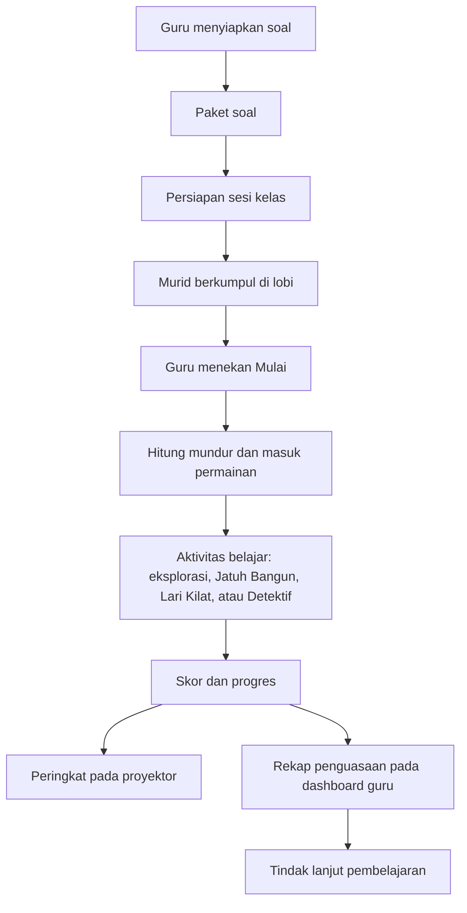

# PRD Multiedu

Status: spesifikasi produk berdasarkan gambar referensi pengguna, belum merupakan fitur yang telah diimplementasikan.

## 1. Tujuan produk

Multiedu menggabungkan pembelajaran berbasis soal dengan petualangan 3D bersama teman sekelas. Guru menyiapkan materi dan memulai permainan, murid menjawab melalui aktivitas di dunia permainan, dan hasil belajar ditampilkan pada papan peringkat serta dashboard penguasaan tujuan pembelajaran (TP).

Dokumen ini memuat daftar fitur dan alur pengguna dari gambar. Aturan tampilan mengikuti [desain.md](./desain.md), sedangkan teknologi dan penamaan mengikuti [rules.md](./rules.md).

### Cara membaca bukti

- **Terlihat:** antarmuka atau tindakan ditampilkan jelas pada gambar.
- **Disebut:** fitur dijelaskan oleh caption atau label, tetapi proses lengkapnya tidak ditampilkan.
- **Usulan:** kebutuhan untuk melengkapi alur; belum dapat dipastikan dari gambar.

Caption promosi tidak dianggap sebagai tombol aplikasi. Angka kapasitas, rumus skor, dan perilaku tersembunyi tidak dianggap terverifikasi hanya dari screenshot.

## 2. Pengguna

| Pengguna | Kebutuhan utama |
| --- | --- |
| Murid | Mengikuti sesi kelas, menggerakkan avatar, membaca misi, menjawab soal, dan melihat progres |
| Guru | Menyiapkan soal, menjalankan sesi, memantau murid, dan mengevaluasi capaian belajar |
| Audiens proyektor | Melihat peringkat dan perubahan skor selama kelas bermain |

Proyektor adalah tampilan sesi, bukan peran akun tersendiri yang terbukti dari gambar. Metode login, pendaftaran, dan cara bergabung ke kelas belum ditampilkan.

## 3. Daftar fitur

### A. Dunia permainan dan sesi kelas

| ID | Fitur | Kebutuhan produk | Bukti |
| --- | --- | --- | --- |
| F-01 | Dunia 3D low-poly | Menampilkan pulau langit, kota, pegunungan, jalan, gedung, dan arena belajar | Terlihat |
| F-02 | Avatar murid | Menampilkan karakter balok dengan nama dan level di atas karakter | Terlihat |
| F-03 | Profil dan XP | Menampilkan nama pemain, level, serta progres XP | Terlihat |
| F-04 | Kontrol pergerakan | Murid dapat bergerak di dunia permainan; tersedia petunjuk joystick | Terlihat/disebut |
| F-05 | Lobi Pulau Langit | Murid berkumpul dan melihat status menunggu guru memulai | Terlihat |
| F-06 | Kesiapan pemain | Menampilkan jumlah teman yang siap di lobi | Terlihat |
| F-07 | Identitas kelas dan sinkronisasi | Menampilkan kelas aktif dan status tersinkron | Terlihat |
| F-08 | Mulai oleh guru | Guru memicu awal permainan bagi peserta kelas | Disebut; posisi kontrol mulai tidak ditampilkan jelas |
| F-09 | Hitung mundur | Menampilkan hitungan menjelang permainan dimulai | Terlihat |
| F-10 | Terjun bersama | Peserta terjun dari lobi menuju dunia permainan, dengan parasut sebagai bagian pengalaman | Terlihat/disebut |
| F-11 | Eksplorasi gedung mapel | Murid mencari gedung mata pelajaran dan menyelesaikan kuis | Disebut melalui panduan langkah dan misi |
| F-12 | Misi dan tantangan | Menampilkan tujuan aktif, progres, dan indikator tantangan | Terlihat; aturan pembuatan tantangan belum jelas |
| F-13 | Toolbar permainan | Menampilkan ikon jeda, dunia, gulungan, pakaian, peta, dan pengaturan pada beberapa layar | Terlihat; fungsi setiap ikon belum seluruhnya terkonfirmasi |
| F-14 | Koin, skor, dan progres | Menampilkan indikator hadiah, skor, waktu, serta progres aktivitas | Terlihat/disebut; rumus perolehan belum ditetapkan |
| F-15 | Banyak pemain dan kelas | Mendukung pengalaman bermain bersama; materi promosi menyebut 70 murid dan 8+ kelas serentak | Disebut; kapasitas teknis wajib diuji sebelum dijanjikan |

### B. Mode belajar

| ID | Fitur | Kebutuhan produk | Bukti |
| --- | --- | --- | --- |
| F-16 | Battle Petualangan | Menghubungkan lobi, terjun, eksplorasi kota, gedung mapel, dan pengumpulan progres | Terlihat/disebut; batas mode versus pengalaman utama belum jelas |
| F-17 | Jatuh Bangun | Murid memilih bidang A–D di arena bertingkat; benar naik dan salah jatuh | Terlihat/disebut |
| F-18 | Soal Jatuh Bangun | Menampilkan nomor soal, pertanyaan, pilihan A–D, lantai, skor, dan waktu | Terlihat |
| F-19 | Lari Kilat | Murid berlari dan memilih lajur/gerbang sesuai jawaban yang dianggap benar | Terlihat/disebut |
| F-20 | Soal Lari Kilat | Menampilkan pertanyaan, pilihan A–D, nomor soal, indikator progres, serta waktu menuju gerbang | Terlihat |
| F-21 | Detektif Kota Ilmu | Mengubah aktivitas membaca menjadi misi pencarian petunjuk di kota | Terlihat/disebut |
| F-22 | NPC dan penanda misi | Menampilkan karakter seperti Pak Budi, papan, dan penanda misi untuk mengarahkan eksplorasi | Terlihat; detail dialog/interaksi belum diperlihatkan |
| F-23 | Berhitung/Pasar | Menyediakan kategori analitik “Berhitung (Pasar)” | Label terlihat; gameplay tidak ditampilkan |

Pilihan jawaban konsisten: A merah, B biru, C hijau, D kuning. Pertanyaan yang terlihat mencakup pecahan dan keliling lingkaran. Konten tidak dibatasi hanya pada contoh tersebut.

### C. Peringkat dan proyektor

| ID | Fitur | Kebutuhan produk | Bukti |
| --- | --- | --- | --- |
| F-24 | Papan peringkat langsung | Menampilkan urutan murid, nama, dan skor dalam sesi aktif | Terlihat |
| F-25 | Tampilan proyektor kelas | Menampilkan peringkat terpisah dari layar permainan murid | Terlihat |
| F-26 | Pembaruan skor bersama | Perubahan skor murid tercermin pada proyektor selama permainan | Disebut; latensi dan protokol tidak terlihat |
| F-27 | Konteks sesi | Menampilkan judul aktivitas dan kelas pada papan peringkat | Terlihat |

### D. Mode guru dan pengelolaan konten

| ID | Fitur | Kebutuhan produk | Bukti |
| --- | --- | --- | --- |
| F-28 | Mode Guru | Menyediakan area kerja guru yang terpisah dari HUD murid | Terlihat |
| F-29 | Navigasi guru | Memuat Beranda, Soal, Kelas & Murid, Tantangan, Paket Saya, dan Lainnya | Terlihat; isi sebagian tab belum diperlihatkan |
| F-30 | Akun dan keluar | Menampilkan identitas guru, tombol Akun, Logout, serta Tutup | Terlihat; alur autentikasi tidak ditampilkan |
| F-31 | Soal buatan guru | Mendukung soal dari guru sendiri | Disebut; formulir manual lengkap tidak terlihat |
| F-32 | Form topik soal AI | Memuat mapel/topik, jenjang/kelas, jumlah soal, jenis soal, dan catatan opsional | Terlihat |
| F-33 | Salin perintah AI | Membuat instruksi yang dapat disalin, dengan opsi melihat isi perintah | Terlihat/disebut |
| F-34 | Tautan layanan AI | Menyediakan akses ke ChatGPT, Gemini, dan Claude untuk menjalankan instruksi | Terlihat |
| F-35 | Impor jawaban AI | Guru menempel hasil AI berupa data soal terstruktur pada textarea | Terlihat |
| F-36 | Tambah ke paket | Memasukkan soal hasil AI ke Paket Saya | Terlihat |
| F-37 | Ganti semua soal | Mengganti isi soal dengan hasil AI | Terlihat |
| F-38 | Tinjau soal dan kunci | Guru dapat memeriksa atau mengubah soal serta memeriksa kunci jawaban sebelum dipakai | Disebut pada petunjuk |
| F-39 | Simpan | Menyimpan hasil pengaturan atau penyusunan soal | Terlihat; cakupan penyimpanan dan backend tidak terlihat |

Alur AI pada gambar adalah **salin perintah → jalankan di layanan AI → tempel jawaban**. Integrasi API AI langsung, API key, dan pembayaran AI tidak menjadi kebutuhan yang terbukti dari gambar.

### E. Dashboard hasil belajar

| ID | Fitur | Kebutuhan produk | Bukti |
| --- | --- | --- | --- |
| F-40 | Analitik per mapel | Menyediakan tab tampilan hasil per mata pelajaran | Label terlihat |
| F-41 | Analitik per TP | Menampilkan grafik rata-rata penguasaan kelas untuk setiap TP | Terlihat |
| F-42 | Garis target capaian | Membandingkan nilai TP dengan ambang acuan/KKTP | Terlihat; cara mengatur ambang belum ditampilkan |
| F-43 | TP perlu diperkuat | Merangkum TP dengan capaian yang perlu ditingkatkan dan saran latihan ulang | Terlihat |
| F-44 | Rekap per murid | Menampilkan tabel murid dan hasil per TP | Terlihat sebagian |
| F-45 | Deskripsi rapor dan remedial | Memanfaatkan rekap penguasaan untuk mendukung deskripsi rapor serta remedial | Disebut; alur pembuatan/ekspor tidak terlihat |
| F-46 | Analitik membaca | Menyediakan tab “Membaca (Detektif)” | Label terlihat; isi detail belum ditampilkan |

## 4. Alur pengguna

### 4.1 Alur utama murid: lobi sampai belajar

**Prasyarat:** murid sudah berada dalam kelas/sesi. Cara masuknya belum terlihat pada gambar.

1. Murid berada di Lobi Pulau Langit bersama avatar peserta lain.
2. Murid melihat identitas, level, status kelas, jumlah teman siap, dan pesan menunggu guru.
3. Guru menekan Mulai; murid menerima hitung mundur.
4. Kelas terjun menuju dunia permainan.
5. Murid bergerak menggunakan kontrol, menjelajahi kota, dan mencari gedung mapel sesuai misi.
6. Murid mengerjakan soal atau aktivitas belajar yang tersedia.
7. Progres, koin, atau skor diperbarui sesuai aturan aktivitas.
8. Skor ditampilkan dalam peringkat kelas.

**Usulan pelengkap:** setelah sesi selesai, tampilkan ringkasan hasil dan pilihan kembali ke lobi. Layar akhir tersebut belum terlihat pada referensi.

### 4.2 Alur murid: Jatuh Bangun

1. Murid berada di arena dengan bidang A, B, C, dan D.
2. Panel menampilkan pertanyaan, empat jawaban, nomor soal, lantai, dan waktu.
3. Murid membaca soal lalu bergerak menuju bidang jawaban pilihannya.
4. Sistem mengevaluasi pilihan pada batas waktu/fase yang ditetapkan.
5. Jika benar, murid naik; jika salah, murid jatuh sesuai deskripsi mode.
6. Progres dan skor diperbarui, kemudian aktivitas berlanjut.

**Belum diketahui:** kapan jawaban terkunci, batas perubahan pilihan, jumlah kesempatan, titik jatuh, kondisi eliminasi, dan akhir permainan. Langkah evaluasi merupakan kebutuhan penghubung alur, bukan detail mekanisme yang terbukti dari screenshot.

### 4.3 Alur murid: Lari Kilat

1. Murid berada di jalan bersama peserta lain.
2. Panel menampilkan soal dan pilihan A–D, disertai informasi waktu/jarak menuju gerbang.
3. Murid memilih jawaban dengan pindah ke lajur gerbang yang sesuai.
4. Ketika mencapai gerbang, sistem mengevaluasi lajur yang dipilih.
5. Progres dan skor diperbarui, lalu murid melanjutkan soal berikutnya.

**Belum diketahui:** kecepatan lari, kontrol otomatis/manual, penalti jawaban salah, rumus skor, serta kondisi selesai. Evaluasi dan kelanjutan soal perlu ditetapkan saat aturan mode dirinci.

### 4.4 Alur murid: Detektif Kota Ilmu

1. Murid berada di kota dan melihat tujuan misi serta karakter/penanda terkait.
2. Murid menuju lokasi petunjuk, misalnya NPC Pak Budi atau papan informasi.
3. Murid membaca informasi dengan teliti untuk memperoleh petunjuk.
4. Murid menggunakan petunjuk untuk melanjutkan misi detektif.

**Belum diketahui:** bentuk panel bacaan, cara mengambil atau menyerahkan petunjuk, urutan tugas, pertanyaan penilaian, serta kondisi misi selesai. Jangan menganggap jurnal, inventori, atau dialog bercabang sebagai fitur yang sudah ditampilkan.

### 4.5 Alur guru: menyusun soal dengan bantuan AI

1. Guru membuka Mode Guru → Soal → pembuatan soal dengan AI.
2. Guru mengisi topik, kelas, jumlah soal, jenis soal, dan catatan opsional.
3. Guru menekan **Salin perintah**; isi instruksi dapat diperiksa melalui **Lihat isi perintah**.
4. Guru membuka ChatGPT, Gemini, atau Claude, menempel perintah, lalu mengirimkannya.
5. Guru menyalin jawaban AI dan kembali ke aplikasi.
6. Guru menempel jawaban pada bagian **Tempel jawaban AI di sini**.
7. Guru memilih **Masukkan soal ke Paket Saya** atau **Ganti semua soal dengan hasil AI**.
8. Guru memeriksa/mengubah soal dan memastikan kunci jawabannya benar.
9. Guru menekan **Simpan**.

**Usulan pelengkap:** validasi format sebelum impor, pesan error yang mempertahankan teks masukan, dan konfirmasi sebelum mengganti semua soal. Ketiganya diperlukan untuk alur yang aman tetapi tidak diperlihatkan sebagai state pada gambar.

### 4.6 Alur guru: menjalankan kelas

1. Guru menyiapkan materi atau paket soal.
2. Guru menyiapkan sesi untuk kelas dan aktivitas yang akan dimainkan.
3. Murid berkumpul di lobi; guru melihat kesiapan peserta.
4. Guru menekan **Mulai**.
5. Kelas menjalani hitung mundur dan permainan bersama.
6. Guru memantau perubahan skor pada papan peringkat/proyektor.
7. Guru melihat rekap penguasaan belajar pada dashboard.

Langkah pemilihan kelas, paket, dan mode merupakan **usulan penghubung alur**: entitas tersebut terlihat pada beberapa layar, tetapi urutan konfigurasi serta kontrolnya belum ditampilkan. Tombol mengakhiri sesi, jeda global, dan penjadwalan belum dapat dipastikan.

### 4.7 Alur proyektor kelas

1. Tampilan proyektor dikaitkan dengan sesi kelas yang berjalan.
2. Proyektor menampilkan judul aktivitas, kelas, urutan murid, dan skor.
3. Saat skor murid berubah dalam permainan, daftar peringkat diperbarui.

Cara membuka atau menghubungkan proyektor ke sesi belum terlihat. Target latensi, pengurutan saat skor sama, dan perilaku saat koneksi putus perlu ditetapkan.

### 4.8 Alur guru: evaluasi dan tindak lanjut

1. Guru membuka dashboard hasil belajar.
2. Guru memilih tampilan **Per TP & deskripsi rapor**.
3. Guru membaca grafik rata-rata penguasaan kelas dan membandingkannya dengan garis target.
4. Guru melihat bagian **TP yang perlu diperkuat** beserta saran latihan.
5. Guru membaca tabel hasil per murid untuk mengenali kebutuhan belajar.
6. Guru menggunakan rekap sebagai dasar latihan ulang, remedial, dan penyusunan deskripsi rapor.

Tab Per mapel, Membaca, dan Berhitung tersedia sebagai pilihan tampilan pada gambar; alur detailnya belum ditampilkan. Ekspor PDF/Excel, cetak rapor, dan pengiriman hasil kepada orang tua belum menjadi ruang lingkup yang terbukti.

## 5. Hubungan antarfitur

Diagram merangkum hubungan produk; tidak menetapkan bahwa semua mode harus dimainkan berurutan atau dalam satu sesi. Hubungan persiapan sesi dan pengolahan rekap masih perlu spesifikasi rinci.

## 6. Kriteria penerimaan utama

Kriteria berikut adalah target untuk implementasi, bukan hasil pengujian saat ini.

| Area | Hasil yang harus dapat diperiksa |
| --- | --- |
| Lobi | Peserta dalam sesi yang sama terlihat bersama; kelas dan jumlah siap sesuai data aktual |
| Mulai sesi | Aksi guru memulai fase permainan bagi peserta sesi yang dituju |
| Soal | Pertanyaan dan jawaban A–D tampil lengkap; pemetaan warna sama pada HUD dan arena |
| Jatuh Bangun | Pilihan dievaluasi sesuai aturan yang ditetapkan; hasil benar/salah menghasilkan progres yang sesuai |
| Lari Kilat | Gerbang/lajur terhubung dengan pilihan jawaban yang sama pada panel |
| Detektif | Petunjuk misi dapat ditemukan melalui bacaan yang relevan, bukan tebakan tanpa informasi |
| Impor AI | Data valid dapat dimasukkan ke paket dan ditinjau; data tidak valid ditolak dengan penjelasan |
| Penyimpanan soal | Soal yang disimpan dapat dibuka kembali tanpa kehilangan isi |
| Proyektor | Perubahan skor tercermin pada sesi yang benar; skor tidak dihitung dua kali |
| Analitik TP | Nilai grafik dan tabel dapat ditelusuri ke hasil latihan murid yang relevan |
| Batas akses | Murid tidak dapat menjalankan aksi guru atau melihat kunci soal aktif |

## 7. Hal yang perlu diputuskan sebelum implementasi rinci

- Metode masuk dan bergabung: akun, kode kelas, tautan undangan, atau mekanisme lain.
- Batas peran guru/murid serta cara menghubungkan proyektor.
- Hubungan Battle Petualangan dengan mode-mode lain dan cara memilih aktivitas.
- Aturan timer, skor, XP, koin, naik level, jawaban terkunci, salah, dan selesai.
- Kapasitas peserta/kelas yang benar-benar ditargetkan dan ukuran uji bebannya.
- Format impor soal AI, jenis soal yang didukung, serta pemetaan soal ke mapel dan TP.
- Rumus penguasaan TP, sumber nilai target, dan hubungan nilai permainan dengan rapor.
- Cakupan CRUD kelas, murid, tantangan, paket, akun, serta fungsi toolbar.
- Perilaku koneksi terputus, bergabung terlambat, dan penyambungan kembali.
- Cakupan mode Berhitung/Pasar serta fitur ekspor hasil.

Tidak ada fitur pembayaran, langganan, toko koin, chat, integrasi API AI langsung, atau aplikasi mobile native yang dapat dipastikan dari gambar. Fitur tersebut memerlukan keputusan ruang lingkup tersendiri.
