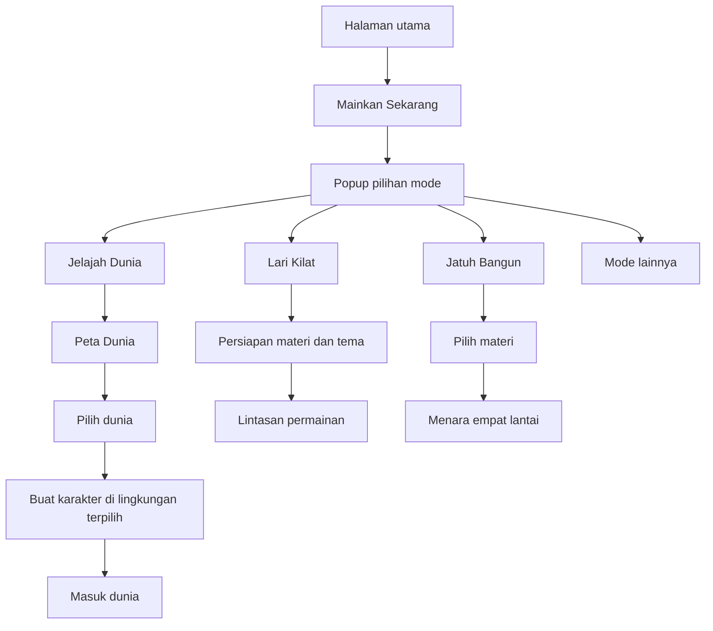

# Alur Permainan Multiedu

Status: **spesifikasi alur untuk implementasi berikutnya**, berdasarkan seluruh gambar dan penjelasan pengguna. Dokumen ini tidak menandakan fitur sudah dibuat atau diuji. Pembuatan dokumen tidak mengubah kode game.

Nama berkas yang digunakan adalah `permainan.md`, menggantikan usulan nama `ALUR-PERMAINAN.md`. Materi Multiedu tetap **Microsoft Word, Microsoft Excel, dan Microsoft PowerPoint**, bukan menyalin daftar mata pelajaran dari situs referensi.

## 1. Kedudukan dokumen

| Dokumen | Tanggung jawab |
| --- | --- |
| [PRD.md](./PRD.md) | Tujuan, daftar fitur, ruang lingkup, dan kebutuhan produk |
| [desain.md](./desain.md) | Tampilan, token visual, komponen, dan responsivitas |
| **permainan.md** | Urutan layar, interaksi, transisi, aturan aktivitas, dan kondisi selesai/gagal |
| [rules.md](./rules.md) | Teknologi, struktur kode, dan penamaan |
| [README.md](./README.md) | Cara menjalankan serta kemampuan implementasi saat ini |

Jika ada detail baru dari referensi yang belum tercantum dalam PRD atau desain, gunakan dokumen ini sebagai catatan alur terbaru untuk perubahan berikutnya. Perubahan ruang lingkup dan visual perlu diselaraskan pada dokumen terkait saat disetujui; jangan menganggap semua rencana di sini sudah tersedia dalam aplikasi.

### Tingkat kepastian

- **Referensi:** terlihat pada gambar atau dijelaskan pengguna.
- **Target Multiedu:** adaptasi yang diminta atau kebutuhan rancangan untuk materi Office.
- **Belum ditetapkan:** perilaku yang tidak dapat disimpulkan dari screenshot. Jangan mengarang aturan sebagai fakta referensi.

## 2. Alur masuk utama

Diagram merupakan target alur, bukan peta halaman yang sudah diimplementasikan. Urutan pemilihan materi dan tema Lari Kilat belum terlihat pada referensi; bagian persiapannya adalah rancangan Multiedu.

### Halaman utama

Target tampilan memakai dunia 3D sebagai latar utama, identitas Multiedu, penjelasan singkat, dan tombol **Mainkan Sekarang**. Akses **Ruang Guru** dipisahkan dari jalur bermain murid. Informasi jumlah soal, gedung, jenjang, dan kapasitas harus sesuai data aktual.

Klik **Mainkan Sekarang** membuka popup pilihan mode di atas halaman yang diredupkan. Ini adalah pemilihan permainan, bukan notifikasi sistem.

### Popup pilihan mode

Kartu mode: **Jelajah Dunia, Lari Kilat, Jatuh Bangun, Detektif Kota Ilmu, Pasar Nusantara, Jembatan Juara**. Setiap kartu berisi ikon, judul, dan deskripsi singkat. Tombol **Tutup** mengembalikan pengguna ke halaman utama.

Referensi menampilkan informasi gratis/tanpa daftar, jenjang aktif, tombol Ganti, Ajak teman, dan petunjuk kode guru. Untuk Multiedu, fitur tersebut hanya diaktifkan setelah alurnya tersedia. Jangan menyajikan undangan teman atau pencatatan kelas seolah berfungsi pada versi latihan individual.

Mode yang belum dibuat diberi label **Belum tersedia** dan tidak membuka arena kosong. Jenjang tidak boleh mengubah materi secara semu jika bank soal per jenjang belum ada.

## 3. Jelajah Dunia dan peta dunia

**Pilih Jelajah Dunia → popup Peta Dunia → pilih Masuk pada kartu → pembuatan karakter → masuk dunia.**

Kartu peta disusun tiga kolom pada desktop dan menyesuaikan layar kecil. Popup dapat digulir tanpa kehilangan akses tombol tutup. Setiap kartu memuat ikon, nama, deskripsi, status, progres gedung, dan tombol **Masuk**.

| Dunia | Lingkungan target | Karakter lingkungan |
| --- | --- | --- |
| Kota Ilmu | Kota dengan plaza, air mancur, jalan, kendaraan, taman, dan gedung Office | NPC warga/guru |
| Samudra | Terumbu karang, dasar laut, ikan, rumput laut, batu, dan gedung berkubah | Penyelam atau robot laut |
| Angkasa | Stasiun orbit, Bulan, dan Mars | Astronaut atau robot |
| Rimba | Hutan tropis, air terjun, pulau satwa, dan gua | Ranger/penjelajah |
| Nusantara | Kepulauan dan landmark Indonesia | Pemandu lokal |
| Mancanegara | Landmark berbagai negara | Pemandu perjalanan |
| Tubuh Manusia | Dunia berskala sel dan lingkungan organ | Pemandu sains |
| Zaman Purba | Lembah dinosaurus, gunung berapi, dan situs purba | Pemandu ekspedisi |
| Lorong Waktu | Lokasi dari beberapa periode sejarah | Pemandu sejarah |
| Iklim Ekstrem | Kutub, gurun, dan pegunungan bersalju | Peneliti/penjelajah |
| Kota Masa Depan | Bangunan futuristis, energi hijau, robot, dan kendaraan terbang | Robot/pemandu teknologi |

Nama dan tema dunia berasal dari referensi; karakter di luar Kota Ilmu dan Samudra merupakan usulan adaptasi. Jangan menganggap seluruh aset atau subwilayah sudah tersedia.

Pemilihan dunia harus mengganti lingkungan dan objek yang relevan, bukan hanya warna latar. Gedung belajar di setiap dunia tetap mengajarkan Word, Excel, dan PowerPoint. Progres ditampilkan sebagai `jumlah gedung selesai / jumlah gedung tersedia` untuk dunia tersebut; angka 0/7 dari referensi tidak disalin otomatis.

Tutup Peta Dunia mengembalikan pengguna ke layar asal. Saat membuka peta dari permainan aktif, lokasi/dunia lama tetap aktif sampai pilihan dunia baru dikonfirmasi.

## 4. Pembuatan avatar

### Layar

Setelah memilih dunia, tampilkan pratinjau 3D lingkungan tersebut di area utama dan panel **Buat Karaktermu** di kanan. Pada ponsel panel dapat ditumpuk tanpa menyembunyikan aksi masuk.

Panel memuat nama pemain, saldo koin, kategori kostum, daftar item, dan tombol **Masuk Dunia**. Kategori mengikuti referensi: **Atasan, Bawahan, Rambut, Warna Rambut, Topi, Wajah**.

### Interaksi

1. Pemain memasukkan nama tampilan; untuk penggunaan tanpa akun gunakan nama samaran.
2. Pemain memilih kategori dan item.
3. Item yang dimiliki langsung diperlihatkan pada pratinjau avatar.
4. Item aktif ditandai dengan bingkai/indikator, bukan warna saja.
5. Item berbayar memperlihatkan harga; item terkunci memperlihatkan level yang diperlukan.
6. Pembelian membutuhkan konfirmasi. Jika saldo tidak cukup atau level belum memenuhi syarat, tampilkan alasan tanpa mengurangi saldo.
7. **Masuk Dunia** menyimpan karakter dan membawa pemain ke titik awal dunia terpilih.

Avatar adalah karakter yang dikendalikan pemain. NPC merupakan karakter sistem yang sudah ditempatkan di dunia; pemain tidak membuat NPC melalui layar ini.

Referensi memperlihatkan saldo awal dan harga yang bervariasi. Saldo awal, harga, daftar kepemilikan, dan level pembuka Multiedu **belum ditetapkan**. Jangan memakai angka referensi sebagai aturan ekonomi otomatis.

## 5. Eksplorasi dan kontrol

HUD menampilkan profil/nama, level, progres XP, misi aktif, dunia aktif, koin, toolbar kanan, serta petunjuk kontrol. Kamera mengikuti pengalaman orang ketiga dengan avatar terlihat di dunia.

| Input desktop | Aksi |
| --- | --- |
| WASD | Berjalan |
| Spasi | Melompat; pada Samudra membantu berenang naik |
| Shift | Berlari |
| E | Berinteraksi dengan objek/NPC terdekat yang memenuhi syarat |
| Esc | Membuka/menutup jeda sesuai konteks |
| Seret mouse | Menggerakkan kamera |

Perangkat sentuh menyediakan gerak, interaksi, dan aksi khusus yang setara. Input permainan dinonaktifkan saat pemain mengisi nama atau berinteraksi dengan dialog.

Untuk Samudra, referensi memberi petunjuk menekan **Renang** atau **Spasi** berulang untuk naik. Kecepatan, batas kedalaman, gravitasi dunia lain, dan collision masih perlu ditentukan. Jangan menyimpulkan sistem oksigen atau damage laut dari gambar.

Objek eksplorasi: gedung materi, NPC, Buku Ilmu, papan misi, lemari kostum, dekorasi, dan penunjuk lokasi. Radius interaksi dan prioritas objek terdekat harus konsisten.

## 6. Gedung belajar Office

**Dekati gedung → petunjuk interaksi → masuk materi/kuis → selesaikan aktivitas → umpan balik → perbarui progres gedung.**

Ini adalah target adaptasi dari petunjuk referensi mengenai gedung mapel; panel detail setelah memasuki gedung belum ditampilkan lengkap.

| Gedung | Contoh materi |
| --- | --- |
| Microsoft Word | Format teks, paragraf, margin, daftar, gambar, dan penyimpanan dokumen |
| Microsoft Excel | Alamat sel, operator, SUM, AVERAGE, tabel, dan pengolahan angka |
| Microsoft PowerPoint | Slide, tata letak, gambar, transisi, animasi, dan presentasi |

Kriteria gedung dinyatakan selesai, jumlah percobaan, ambang kelulusan, dan nilai yang dipakai pada pengulangan **belum ditetapkan**. Selesaikan aturan tersebut sebelum menghubungkan aktivitas ke rapor atau analitik TP.

## 7. NPC dan aktivitas bantuan

**Dekati NPC bertanda seru → petunjuk E/Bicara → dialog → Nanti saja atau Bantu → pertanyaan → hasil.**

Referensi memperlihatkan Bu Sari menawarkan teman belajar. NPC lain terlihat sebagai warga dengan identitas sendiri.

- Petunjuk bicara tampil hanya dalam jangkauan interaksi.
- **Nanti saja** menutup dialog dan kembali ke eksplorasi.
- **Bantu** membuka pertanyaan atau aktivitas warga.
- Panel pertanyaan memuat nama NPC, materi, pertanyaan, jawaban A–D, tombol suara, dan **Keluar**.
- Setelah menjawab, target Multiedu menampilkan hasil serta pembahasan yang relevan.
- Keluar dari pertanyaan tidak otomatis memberi hadiah atau menyelesaikan misi.

Contoh adaptasi: NPC Word meminta bantuan format dokumen, NPC Excel meminta rumus, dan NPC PowerPoint meminta pilihan desain presentasi yang tepat.

Batang hijau pada panel referensi belum dapat dipastikan sebagai timer atau progres. Besar hadiah, batas pengulangan bantuan, serta akibat jawaban salah belum ditetapkan. Perubahan koin/XP antargambar bukan bukti besaran hadiah NPC.

Kuis NPC dan kuis gedung adalah aktivitas berbeda. Kuis warga tidak otomatis menyelesaikan misi “selesaikan kuis di satu gedung”.

## 8. Buku Ilmu

Referensi mengonfirmasi buku sebagai objek koleksi dengan notifikasi **Buku Ilmu ditemukan! +5 koin**.

Alur target:

1. Pemain mendekati/menyentuh Buku Ilmu dalam radius koleksi.
2. Sistem memeriksa apakah buku tersebut belum dikoleksi.
3. Koleksi dicatat, buku dinonaktifkan untuk pemain, dan **5 koin** diberikan.
4. Jumlah buku serta progres misi koleksi diperbarui.
5. Tampilkan notifikasi singkat tanpa menutup kontrol penting.

Buku memiliki identitas unik agar peristiwa yang diterima dua kali tidak menggandakan hadiah. Ini tidak membuktikan buku juga memberi XP. Angka dalam tanda kurung pada screenshot belum pasti berarti jumlah koleksi; Multiedu harus menggunakan label eksplisit, misalnya `Buku terkumpul: 7`.

Aturan buku muncul kembali, batas koleksi per hari, dan apakah status koleksi dibagi antar-dunia belum ditetapkan.

## 9. Toolbar kanan

| Tombol | Perilaku target |
| --- | --- |
| Jeda (Esc) | Membuka panel jeda dengan aksi lanjut dan keluar; isi lengkap referensi belum terlihat |
| Peta Dunia | Membuka pilihan dunia; perpindahan menjelaskan dampak pada aktivitas yang sedang berjalan |
| Misi | Membuka Papan Misi dengan tab Misi, Profil, Penguasaan, Riwayat, dan Lencana |
| Lemari Kostum | Membuka penggantian penampilan dengan preview dan status item |
| Peta Mini | Menampilkan/menyembunyikan navigasi posisi dan arah pemain |
| Pengaturan | Membuka kontrol grafis, suara, fitur pendukung, dan navigasi |

Peta mini mengikuti dunia dan posisi pemain. Gunakan legenda untuk NPC, gedung, dan koleksi; makna setiap titik pada referensi belum diketahui. Peta mini tidak boleh menjadi satu-satunya cara menemukan tujuan.

### Jeda dan modal

Pada latihan individual, jeda menghentikan simulasi serta timer aktivitas. Pada kelas multiplayer, jeda pribadi tidak menghentikan waktu server atau peserta lain. Dialog mengelola fokus keyboard; tutup mengembalikan fokus ke pemicu. Esc menutup dialog teratas dahulu, bukan menumpuk panel jeda di atasnya.

## 10. Misi, profil, penguasaan, riwayat, dan lencana

Papan Misi menampilkan tujuan, progres, hadiah, dan status. Referensi memperlihatkan misi kuis pertama, koleksi buku, membaca materi, membantu warga, jawaban benar berturut-turut, semua gedung selesai, nilai sempurna, level, serta misi harian.

Contoh adaptasi Multiedu:

| Misi | Pemicu progres |
| --- | --- |
| Langkah Pertama | Kuis gedung Office diselesaikan sesuai aturan kelulusan |
| Kolektor Buku | Buku unik berhasil dikoleksi |
| Pelajar Teliti | Materi Office selesai dibaca sesuai definisi penyelesaian |
| Penolong Warga | Aktivitas NPC berhasil diselesaikan |
| Combo Jawaban | Jawaban benar berurutan pada aktivitas yang ditetapkan |
| Penjelajah Office | Gedung Word, Excel, dan PowerPoint dalam dunia selesai |
| Nilai Sempurna | Hasil kuis memenuhi nilai maksimum |
| Pelajar Rajin | Akumulasi jawaban benar mencapai target |

Target jumlah, hadiah, reset combo, dan periode hitung perlu dikonfigurasi. Jangan menganggap membuka panel materi saja sebagai bukti telah belajar.

Status misi target: **Belum selesai → Syarat terpenuhi → Siap diklaim → Sudah diklaim**. Hadiah hanya diberikan sekali per penyelesaian. Papan misi dalam dunia dapat membuka panel yang sama dengan toolbar. Misi harian membutuhkan aturan pergantian hari dan zona waktu yang eksplisit.

Isi rinci tab Profil, Penguasaan, Riwayat, dan Lencana belum terlihat; jangan menganggap seluruh statistik atau penghargaan di tab tersebut sudah diketahui.

## 11. Lemari kostum dan ekonomi

**Buka lemari → pilih kategori → pilih item → pakai/beli bila memenuhi syarat → Selesai → kembali ke dunia.**

Lemari dari toolbar atau kios dunia memakai kepemilikan yang sama dengan layar pembuatan karakter. Konfirmasi pembelian harus menjelaskan harga dan saldo setelah pembelian. Batalkan tidak mengurangi saldo. Item terkunci tidak dapat dibeli/dipakai dengan mengabaikan syarat level.

Bedakan empat nilai berikut:

- **Koin:** mata uang hadiah dan pembelian kostum.
- **XP:** progres menuju level pemain.
- **Skor/bintang sesi:** hasil aktivitas; hubungan bintang dengan jawaban benar belum terbukti.
- **Progres misi/gedung:** pencapaian tujuan, bukan saldo yang dapat dibelanjakan.

Rumus XP per level, hadiah NPC/kuis, dan konversi skor ke XP belum ditetapkan. Jangan otomatis menerapkan ekonomi baru pada hasil latihan lama.

## 12. Pengaturan

Kontrol yang terlihat pada referensi:

- Grafik **Tinggi (bayangan)** atau **Ringan (HP lama)**.
- Suara nyala/mati.
- Main bersama nyala/mati.
- Bacakan soal otomatis nyala/mati.
- Mode Guru.
- Beranda.
- Hapus progres.

Target Multiedu: perubahan grafik benar-benar mengubah kualitas/bayangan, mute menghentikan audio, dan pembacaan soal mempertimbangkan dukungan perangkat. Bila suara pembaca tidak tersedia, beri penjelasan; jangan tampilkan status bekerja secara semu.

Main bersama hanya aktif jika sesi jaringan tersedia. Mode Guru tetap memerlukan otorisasi saat akun/peran diterapkan. Beranda meminta konfirmasi bila ada sesi yang belum selesai. Hapus progres menyebut data yang akan hilang, meminta konfirmasi, dan tidak menghapus data kelas/pengguna lain.

## 13. Lari Kilat

### Persiapan

Target: **Pilih Lari Kilat → pilih materi dan tema → petunjuk → mulai lintasan**. Referensi belum memperlihatkan urutan layar pemilihan tema/materi, sehingga urutan ini merupakan rancangan Multiedu.

Materi: **Campur semua materi Office, Microsoft Word, Microsoft Excel, Microsoft PowerPoint**. Tema sesuai penjelasan pengguna: **Pantai, Kota, Luar Angkasa**. Gambar juga menampilkan sawah/pondok; belum dipastikan sebagai tema keempat atau variasi lingkungan.

### Putaran permainan

1. Pemain bergerak maju di lintasan empat lajur; target awal adalah gerak maju otomatis dengan kontrol perpindahan lajur, sedangkan mekanisme otomatis ini belum dapat dibuktikan hanya dari screenshot.
2. Koin dan rintangan muncul sepanjang jalur.
3. Pada fase soal, pertanyaan serta pilihan A–D tampil bersama hitung mundur menuju gerbang.
4. Pemain memilih lajur sesuai jawaban.
5. Saat melewati gerbang, sistem mengunci dan mengevaluasi pilihan.
6. Tampilkan hasil serta perubahan nilai sesuai aturan yang ditetapkan.
7. Di antara soal, tampilkan pesan mengumpulkan koin/menghindari rintangan.
8. Ulangi sampai kondisi sesi selesai, lalu tampilkan ringkasan dan aksi main lagi/kembali.

Pemetaan dari kiri ke kanan: **A merah, B biru, C hijau, D kuning**. HUD memuat nomor soal, indikator bintang, koin, jarak, profil/XP, peta mini, dan toolbar.

Referensi memperlihatkan sepuluh soal, contoh hitung mundur 4–5 detik, angsa mengejar pada kondisi tertentu, dan penghalang “Runduk”. Angka ini adalah bukti tampilan referensi, belum nilai baku Multiedu.

### Belum ditetapkan

Kecepatan, kontrol runduk/lompat, jumlah soal, waktu baca yang layak, hadiah koin lintasan, penalti tabrakan/salah, fungsi bintang, pemicu angsa, kondisi tertangkap, dan akhir sesi. Pilihan berbasis tombol/touch harus disediakan sebagai akses yang setara dengan perpindahan lajur.

## 14. Jatuh Bangun

### Persiapan

**Pilih Jatuh Bangun → pilih materi → masuk arena menara empat lantai.**

Pilihan Multiedu:

1. Campur semua materi Office.
2. Microsoft Word.
3. Microsoft Excel.
4. Microsoft PowerPoint.

### Arena dan aturan yang diketahui

Arena berupa platform melayang bertingkat di atas lingkungan dunia. Setiap lantai memiliki empat bidang:

| Posisi | Pilihan | Warna |
| --- | --- | --- |
| Kiri atas | A | Merah |
| Kanan atas | B | Biru |
| Kiri bawah | C | Hijau |
| Kanan bawah | D | Kuning |

1. Panel menampilkan pertanyaan, pilihan A–D, nomor soal, lantai aktif, bintang, dan timer.
2. Pemain bergerak ke bidang jawaban sebelum waktu habis.
3. Posisi ketika timer berakhir menentukan jawaban; konfirmasi manual bukan mekanisme utama mode ini.
4. Jawaban benar menaikkan pemain satu lantai.
5. Jawaban salah memicu jatuh sesuai aturan lantai yang akan ditetapkan.
6. Kamera dan avatar mengikuti perubahan ketinggian; bukan sekadar animasi pantulan.
7. Lanjutkan putaran atau tampilkan hasil sesuai kondisi selesai.

Referensi menampilkan empat lantai dan sesi delapan soal. Nilai tersebut tidak otomatis mengubah bank soal implementasi saat ini. Input alternatif aksesibel harus memilih bidang dengan aturan waktu yang sama.

### Belum ditetapkan

- Apakah jatuh turun satu lantai atau kembali ke dasar.
- Akibat salah di lantai pertama.
- Penanganan avatar di luar bidang atau tepat pada batas bidang saat timer habis.
- Penanganan lantai keempat, tujuan puncak, dan kondisi menang.
- Jumlah soal Multiedu, durasi, hadiah, serta apakah ada eliminasi.

Sebelum implementasi, pilih satu aturan untuk setiap kondisi dan tampilkan dalam petunjuk. Jangan menjadikan ketidakjelasan ini sebagai perilaku acak.

## 15. Mode lain

| Mode | Alur yang diketahui/diusulkan | Batas pengetahuan |
| --- | --- | --- |
| Detektif Kota Ilmu | Terima kasus → baca petunjuk di lokasi → jawab → simpulkan | Referensi menyebut kesaksian, berita, surat, dan empat lokasi; panel rinci belum diperlihatkan |
| Pasar Nusantara | Terima kebutuhan pembeli → hitung belanja/kembalian/diskon → serahkan jawaban | Baru deskripsi kartu; adaptasi Office dan gameplay belum disepakati |
| Jembatan Juara | Jawab soal → buka bagian jembatan → seberangi pulau → finis | Baru deskripsi kartu; aturan gagal dan kontrol belum ditampilkan |

Rancangan tematik Office, misalnya transaksi berbasis Excel atau membaca instruksi Word, adalah usulan. Jangan mengganti materi utama dengan mata pelajaran lain tanpa keputusan pengguna.

## 16. Alur guru, kelas, dan proyektor

Referensi awal memperlihatkan pembuatan soal, lobi kelas, mulai bersama, peringkat proyektor, dan analitik. Pertahankan hubungan berikut tanpa menganggapnya sudah tersedia:

- **Konten:** Mode Guru → Soal → isi topik/kelas/jumlah/jenis → salin perintah → jalankan di ChatGPT/Gemini/Claude → tempel hasil → validasi/tinjau kunci → tambahkan ke paket atau konfirmasi penggantian → Simpan.
- **Sesi:** pilih kelas/paket/mode → buka lobi → murid bergabung → periksa siap → guru Mulai → hitung mundur → aktivitas → hasil.
- **Proyektor:** hubungkan ke sesi → tampilkan peserta/peringkat → perbarui skor dari sesi yang sama.
- **Evaluasi:** dashboard → per mapel/TP → lihat capaian dan kebutuhan latihan → tinjau tindak lanjut/rapor.

Bagian konfigurasi sesi merupakan penghubung rancangan; layar lengkapnya belum ditampilkan. Kode guru pada halaman awal harus divalidasi dan diarahkan ke sesi yang tepat; format kode final, autentikasi, bergabung terlambat, dan reconnect perlu ditentukan.

Pembantu AI pada referensi adalah salin-tempel, bukan integrasi API AI otomatis. Proyektor dan peserta hanya diberi status tersinkron setelah koneksi benar-benar siap. Metrik TP tidak boleh disamakan begitu saja dengan jumlah koin atau XP.

## 17. Penyimpanan dan kegagalan

Data target: identitas/penampilan, saldo, XP/level, kepemilikan item, koleksi buku, misi/klaim hadiah, progres gedung per dunia, dan hasil sesi.

- Simpan perubahan yang berkaitan secara konsisten; pembelian gagal tidak boleh mengurangi koin tanpa memberi item.
- Berikan identitas per transaksi/koleksi/jawaban agar pengiriman ulang tidak menggandakan hadiah.
- Jika simpan gagal, tampilkan status gagal dan langkah coba lagi; jangan mengklaim tersimpan.
- Pisahkan progres pemain, hasil sesi, dan hasil kelas.
- Saat keluar/ganti dunia, jelaskan apakah aktivitas batal atau dapat dilanjutkan.
- Saat koneksi putus, jangan membuat nilai baru di klien seolah sudah disahkan server.
- Saat reconnect, ambil status terbaru sebelum melanjutkan timer atau hadiah.
- Penghapusan progres harus terbatas pada data yang disebut dalam konfirmasi.

Versi kode saat ini masih menggunakan latihan individual, sesi dalam memori, dan hasil selesai di JSON lokal server. Target penyimpanan di atas belum diimplementasikan hanya karena dokumen ini dibuat.

## 18. Kriteria penerimaan

- [ ] Mainkan Sekarang membuka pilihan mode; tutup/kembali mengarah ke asal yang benar.
- [ ] Jelajah Dunia membuka peta, kemudian pembuatan karakter di lingkungan yang dipilih.
- [ ] Seluruh dunia memiliki status ketersediaan jujur dan progres dari data aktual.
- [ ] Kostum memperbarui avatar; pembelian dan syarat level tidak dapat dilewati.
- [ ] NPC menampilkan petunjuk interaksi dalam jangkauan dan membuka dialog yang sesuai.
- [ ] Buku memberi 5 koin sekali per koleksi sah dan memperbarui misi.
- [ ] Koin, XP, skor, dan progres dibedakan di UI dan penyimpanan.
- [ ] Toolbar, jeda, fokus modal, peta mini, dan pengaturan memiliki tindakan nyata.
- [ ] Lari Kilat mengevaluasi lajur saat melewati gerbang; tema tidak mengubah pemetaan jawaban.
- [ ] Jatuh Bangun mengevaluasi posisi saat timer berakhir dan benar-benar berpindah lantai.
- [ ] Seluruh aturan belum ditetapkan pada bagian 13–14 diselesaikan sebelum gameplay tersebut dibuat.
- [ ] Hadiah, jawaban, dan transaksi aman terhadap pengiriman ulang.
- [ ] Keyboard, sentuhan, teks panjang, serta pengurangan gerak diperiksa.
- [ ] Mode, kelas, dan proyektor yang belum tersedia tidak ditampilkan seolah berfungsi.

Checklist ini adalah target peninjauan berikutnya, bukan laporan pengujian. Dokumen tidak memberikan otorisasi untuk deployment, publikasi environment, atau push GitHub otomatis.

## 19. Keputusan implementasi Multiedu

Aturan yang sebelumnya belum ditetapkan kini memakai keputusan awal berikut (bukan klaim perilaku situs referensi):

- Seluruh 11 dunia dibuat sebagai satu area prosedural per tema. Subwilayah seperti Bulan/Mars belum menjadi area terpisah.
- Kuis memakai bank 6 soal per materi atau 18 soal campuran. Jembatan mengambil 6 soal, Detektif kasus Word 2 soal setelah 4 petunjuk, Pasar 3 transaksi Excel.
- Jatuh Bangun memakai 15 detik; benar naik satu, salah/tidak memilih turun satu. Lantai dibatasi 1–4 dan tidak ada eliminasi. Batas bidang dipilih melalui posisi/input alternatif A–D; pilihan terakhir yang diterima server sebelum deadline dipakai saat evaluasi.
- Lari Kilat memakai gerbang 12 detik, koin lintasan maksimum 1 per soal, rintangan pada detik keenam sebelum gerbang, tabrakan mengurangi skor 25 dengan minimum 0. Angsa merupakan indikator visual tekanan, tanpa mekanisme tertangkap/eliminasi.
- Semua mode selesai ketika soal habis. Benar +100 XP; hasil selesai memberi 2 koin per jawaban benar. XP naik level setiap 500. Buku tetap +5 koin, sekali per buku per dunia/profil, tanpa respawn harian.
- Kuis gedung lulus pada ketepatan minimal 50%; kuis NPC tidak mengesahkan gedung. Penguasaan adalah rata-rata ketepatan materi, bukan penilaian TP kurikulum.
- Klaim misi dan harga/syarat kostum ditetapkan pada katalog server. Misi harian mengikuti UTC. Pembacaan materi dikonfirmasi pemain sebelum kuis.
- Kelas memakai akun guru lokal, kode 6 angka, semua peserta siap sebelum mulai, hitung mundur 3 detik, soal individual dalam sesi kelas, dan papan skor bersama. Komunikasi memakai polling; gerak avatar lintas perangkat belum disinkronkan.
- Penyimpanan versi ini adalah JSON server satu proses, dengan transaksi serial dan rename atomik. PostgreSQL, Socket.IO dan dunia fisika multiplayer bersama tetap target lanjutan. Jangan menyatakan versi ini siap produksi sekolah atau teruji untuk 70 pemain.

README menjelaskan perilaku yang tersedia dan batas operasional. Checklist bagian 18 tetap merupakan kriteria peninjauan; status lulus ditentukan oleh pengujian, bukan keberadaan dokumen atau tombol.

## 20. Tata kota terbaru

Kota Ilmu diperluas menjadi area 88 × 88 unit dengan jaringan jalan, sembilan blok, plaza pusat, dan permukiman. Gedung Word, Excel, dan PowerPoint ditempatkan pada baris utara. Mobil/bus bergerak pada lintasan melingkar dalam dan luar; menu menjeda lalu lintas. Gapura pusat mempunyai tulisan depan SELAMAT DATANG dan tulisan belakang KOTA ILMU. Kamera memiliki mode pandangan kota penuh dan mode dekat yang mengikuti pemain. Semua objek, tulisan, dan animasi tetap dibuat lokal untuk penggunaan offline.
